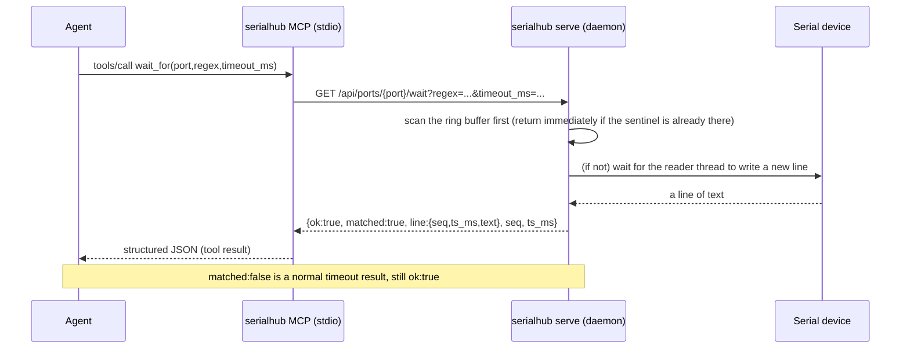

**English** · [简体中文](MCP.zh-CN.md)

# serialhub MCP guide

This document is for **AI agents that operate serial ports with serialhub** (and for engineers configuring
MCP for those agents). It exposes the persistent `serialhub serve` daemon as **14 MCP tools**, letting an
agent complete the whole flow of "list ports → open → wait/read/search → send → snapshot/export/bridge"
through tool calls.

> Contract source: [`ARCHITECTURE.md`](ARCHITECTURE.md) §11; implementation: [`../serialhub/mcp_server.py`](../serialhub/mcp_server.py).
> Main manual: [`../README.md`](../README.md).

---

## 1. Transport and process model

- **Transport**: stdio (default). The command is `python -m serialhub mcp --stdio`, or run `serialhub/mcp_server.py` directly.
- **Thin client**: the MCP server **does not open serial ports itself**; every tool calls the persistent daemon
  over HTTP (`serialhub.client.Client`, stdlib `urllib.request`). So **the daemon must be started first** (`serialhub serve`).
- **Non-blocking**: blocking tools (`wait_for`, `send+wait`) run on a worker thread (`asyncio.to_thread`), so the
  MCP event loop is not stalled.
- **Compatibility**: `mcp_compat.py` supports both the official SDK 1.x (`FastMCP`) and 2.x (`MCPServer`), with no
  code changes needed per version.

```
        ┌──────────────┐   MCP (stdio/JSON-RPC)   ┌──────────────────┐   HTTP/REST   ┌────────────────────┐
        │    Agent      │ ───────────────────────▶ │  serialhub MCP    │ ───────────▶  │  serialhub serve    │
        │  (tool calls) │ ◀─────────────────────── │  (stdio server)   │ ◀───────────  │  Hub + RingBuffer   │
        └──────────────┘   structured JSON result  └──────────────────┘  {ok,...}/    └─────────┬──────────┘
                                                                           {ok:false}             │ serial / TCP bridge
                                                                                                  ▼
                                                                                            (COMx / loop:// / ...)
```



---

## 2. Install and self-check

```powershell
pip install -r requirements.txt      # runtime
pip install "mcp>=1.9"               # MCP support (or pip install -r requirements-dev.txt)

# Protocol self-check (hand-written stdio JSON-RPC client, no daemon needed)
python tools/mcp_smoke.py
#   initialize + tools/list -> should print 14 tools and end with "# RESULT: PASS"

# End-to-end smoke (needs the daemon running)
python -m serialhub serve --config examples/config.yaml
python tools/mcp_smoke.py --full --tool-timeout 30
#   initialize + tools/list + list_ports -> "# RESULT: PASS"
```

`tools/mcp_smoke.py` speaks JSON-RPC 2.0 directly (it does not depend on an SDK client), so when it passes it
proves the `initialize` / `tools/list` / `tools/call` contract is correct.

---

## 3. Register with a client

### opencode

```jsonc
"mcp": {
  "serialhub": {
    "type": "local",
    "command": ["python", "D:\\projects\\project\\h750\\keshe\\serialhub\\serialhub\\mcp_server.py"],
    "enabled": true,
    "environment": { "SERIALHUB_URL": "http://127.0.0.1:8765" }
  }
}
```

The equivalent module form (needs `import serialhub` to work, e.g. after `pip install -e .`):
`"command": ["python", "-m", "serialhub", "mcp", "--stdio"]`.

### Claude Desktop (`claude_desktop_config.json`)

```json
{
  "mcpServers": {
    "serialhub": {
      "command": "python",
      "args": ["D:\\projects\\project\\h750\\keshe\\serialhub\\serialhub\\mcp_server.py"],
      "env": { "SERIALHUB_URL": "http://127.0.0.1:8765" }
    }
  }
}
```

### Cursor (`.cursor/mcp.json`)

```json
{
  "mcpServers": {
    "serialhub": {
      "command": "python",
      "args": ["D:\\projects\\project\\h750\\keshe\\serialhub\\serialhub\\mcp_server.py"],
      "env": { "SERIALHUB_URL": "http://127.0.0.1:8765" }
    }
  }
}
```

### Environment variables

| Variable | Default | Notes |
|---|---|---|
| `SERIALHUB_URL` | `http://127.0.0.1:8765` | Daemon base (keep this in sync when you change the port) |
| `SERIALHUB_TOKEN` | empty | Fill the same Bearer token when the daemon sets `server.token` |

---

## 4. Error conventions

- **Every tool** uniformly returns `{"ok": true, ...}` or `{"ok": false, "error": "<readable message>"}`.
  The MCP JSON-RPC layer itself does not raise; `ok:false` appears in the **tool result content**.
- Common error mapping (from the daemon's HTTP layer):

| `error` example | HTTP | Trigger |
|---|---|---|
| `connection failed: ...` | (client) | Daemon not started / wrong address |
| `unknown port: 'nope'` | 404 | Port name not in the config |
| `<ValueError text>` | 400 | Invalid argument (e.g. an unrecognized `export` format) |
| `<RuntimeError text>` | 409 | e.g. `send` before the device is open |
| `invalid request` | 422 | Request body missing a field / wrong type |
| `unauthorized` | 401 | The daemon sets a token but it wasn't sent correctly |

- **A `wait_for` timeout is not an error**: if nothing arrives within 15s it returns
  `{"ok": true, "matched": false, "line": null, "seq": null, "ts_ms": null, "from_seq": <start>}`.
  The agent should branch on `matched` rather than treating a timeout as a failure.

---

## 5. Tool reference (14)

Convention: the defaults in the "Args" tables below are the tool-signature defaults; "Returns" omits the
common `ok` / `port` fields.

---

### 5.1 `list_ports`

List system serial ports + configured ports (with open state, buffer stats, and bridge state).

| Args | Type | Required | Default | Notes |
|---|---|---|---|---|
| (none) | | | | |

Key return fields:

| Field | Notes |
|---|---|
| `system[]` | System serial ports: `{device, description, hwid}` |
| `ports[]` | Configured ports: `{name, device, description, open, baud, data_bits, parity, stop_bits, flow, rx_lines, tx_lines, last_error, reconnect_count, buffer, tcp_bridge}` |
| `buffer` | `{count, bytes, first_seq, last_seq, dropped_total}` |
| `tcp_bridge` | `{mode, port, host, active}` or `null` |

```json
{"ok":true,"system":[{"device":"COM11","description":"USB-SERIAL CH340","hwid":"USB VID:PID=1A86:7523"}],
 "ports":[{"name":"console","device":"COM11","open":true,"baud":921600,"buffer":{"count":1281,"bytes":91234,"first_seq":3,"last_seq":1284,"dropped_total":0},"tcp_bridge":null}]}
```

**When to use**: list ports at the start of every session; confirm whether the target port is open, how many lines
are buffered, and the cursor start (`first_seq`/`last_seq`).

---

### 5.2 `open`

Open (or reopen) a port, optionally overriding baud / device path.

| Args | Type | Required | Default | Notes |
|---|---|---|---|---|
| `port` | str | yes | | Logical port name (e.g. `console`) |
| `baud` | int | no | `115200` | Baud override |
| `device` | str | no | `null` | Device path override (`COM11` / `/dev/ttyUSB0`) |

Returns: the port dict (`open:true`, including `buffer` / `tcp_bridge`).

```json
{"ok":true,"name":"console","device":"COM11","open":true,"baud":921600,"data_bits":8,"parity":"N","stop_bits":1.0,"flow":"none","rx_lines":0,"tx_lines":0,"last_error":null,"reconnect_count":0,"buffer":{"count":0,"bytes":0,"first_seq":null,"last_seq":null,"dropped_total":0},"tcp_bridge":null}
```

**When to use**: when a port is `autostart:false`, or right after a `close` when you need to reopen it.

---

### 5.3 `close`

Close a port (**the buffer is kept**).

| Args | Type | Required | Default |
|---|---|---|---|
| `port` | str | yes | |

Returns: the port dict (`open:false`).

```json
{"ok":true,"name":"console","device":"COM11","open":false,"baud":921600,"buffer":{"count":1281,"bytes":91234,"first_seq":3,"last_seq":1284,"dropped_total":0},"tcp_bridge":null}
```

**When to use**: to hand the serial port to another program, or to pause sampling temporarily without losing history.

---

### 5.4 `status`

Daemon/port status. Omit `port` for the overall view.

| Args | Type | Required | Default | Notes |
|---|---|---|---|---|
| `port` | str | no | `null` | If omitted, returns daemon-level status |

Returns: with a given `port` -> the single-port dict **plus** `server`; omitted -> `{server, ports[]}`.

| `server` field | Notes |
|---|---|
| `host` / `port` | Listen address/port |
| `version` | serialhub version |
| `uptime_ms` | Milliseconds the daemon has been running |

```json
{"ok":true,"server":{"host":"127.0.0.1","port":8765,"version":"0.1.0","uptime_ms":32045},"ports":[{"name":"console","open":true,"device":"COM11","last_error":null,"reconnect_count":0,"buffer":{"count":1281,"bytes":91234,"first_seq":3,"last_seq":1284,"dropped_total":0}}]}
```

**When to use**: health checks; confirming `last_error` / `reconnect_count` (disconnect diagnosis).

---

### 5.5 `read`

Read buffered lines **incrementally by cursor** (no double consumption). This is the core read tool.

| Args | Type | Required | Default | Notes |
|---|---|---|---|---|
| `port` | str | yes | | Logical port name |
| `since_seq` | int | no | `null` | Return `seq > since_seq` (**preferred cursor**) |
| `since_ts` | int | no | `null` | When no `since_seq`, use `ts_ms > since_ts` |
| `filter` | str | no | `null` | Regex; return only matching lines |
| `limit` | int | no | `null` | Max lines to return |
| `strip_ansi` | bool | no | `false` | Strip ANSI escapes |

Key return fields:

| Field | Notes |
|---|---|
| `lines[]` | Old→new: `{seq, port, ts_ms, text, ansi, kind}` |
| `count` | Line count this call |
| `next_seq` | Cursor for the next resume (= the last returned line's `seq`) |
| `dropped` | Lines permanently lost to buffer eviction (>0 when the cursor predates `first_seq-1`) |
| `has_more` | There are still matching lines not returned |
| `first_seq` / `last_seq` | Oldest/newest `seq` in the current buffer |

```json
{"ok":true,"port":"console","lines":[{"seq":58,"port":"console","ts_ms":1730000000150,"text":"[BOOT] stage 2","ansi":false,"kind":"rx"}],"count":1,"next_seq":58,"dropped":0,"has_more":false,"first_seq":3,"last_seq":58}
```

**When to use**: routine reads. Start with `since_seq:0` or a `snapshot` to see the start; once you have `next_seq`,
keep passing it as `since_seq`. When `dropped>0`, resume from `first_seq` instead.

---

### 5.6 `search`

Regex search over the whole buffer, optionally with a context window (for locating, not incremental).

| Args | Type | Required | Default | Notes |
|---|---|---|---|---|
| `port` | str | yes | | |
| `regex` | str | yes | | Regex |
| `context` | int | no | `0` | How many lines to take before/after each hit |
| `since_seq` | int | no | `null` | Search only `seq > since_seq` |
| `limit` | int | no | `null` | Max hits |

Key return fields:

| Field | Notes |
|---|---|
| `hits[]` | `{seq, ts_ms, text, kind, match, context_before[], context_after[]}` |
| `count` | Hit count |
| `next_seq` | The last hit's `seq` (usable as a resume-search cursor) |
| `regex` | Echoes the regex used |

```json
{"ok":true,"port":"console","hits":[{"seq":91,"ts_ms":1730000000444,"text":"[ERR] HardFault handler entered","kind":"rx","match":"HardFault","context_before":[{"seq":90,"ts_ms":1730000000440,"text":"[BOOT] started"}],"context_after":[{"seq":92,"ts_ms":1730000000446,"text":"pc=0x90001234"}]}],"count":1,"next_seq":91,"regex":"HardFault"}
```

**When to use**: forensics after a `wait_for` timeout (search `HardFault|ASSERT|panic`); locating state transitions in long logs.

---

### 5.7 `wait_for`

**Block** until a new line matches a regex (or a timeout). The core sentinel tool.

| Args | Type | Required | Default | Notes |
|---|---|---|---|---|
| `port` | str | yes | | |
| `regex` | str | yes | | The sentinel to wait for |
| `timeout_ms` | int | no | `10000` | Max wait in milliseconds |
| `since_seq` | int | no | `null` | Consider only `seq > since_seq` |

Key return fields:

| Field | Notes |
|---|---|
| `matched` | `true` on a hit; `false` on timeout (**still `ok:true`**) |
| `line` | The hit line `{seq, port, ts_ms, text, ansi, kind}`, or `null` |
| `seq` / `ts_ms` | The hit line's sequence/time (`null` on timeout) |
| `from_seq` | The start cursor for this wait |

Hit:
```json
{"ok":true,"port":"console","matched":true,"line":{"seq":57,"port":"console","ts_ms":1730000001234,"text":"[BOOT] Bootloader v1.3.0 starting","ansi":false,"kind":"rx"},"seq":57,"ts_ms":1730000001234,"from_seq":42}
```

Timeout:
```json
{"ok":true,"port":"console","matched":false,"line":null,"seq":null,"ts_ms":null,"from_seq":42}
```

Behavior details: it scans the ring buffer first and **returns an already-present match immediately**; otherwise it
subscribes to the broadcast and blocks waiting. When `since_seq` is given, only `seq > since_seq` is considered.

**When to use**: waiting for a boot banner / a command prompt / an "OK/ERROR" conclusion text. **Always branch on `matched`.**

---

### 5.8 `send`

Write data to a port (EOL appended), optionally waiting for a reply.

| Args | Type | Required | Default | Notes |
|---|---|---|---|---|
| `port` | str | yes | | |
| `data` | str | yes | | Payload (**without** the terminator) |
| `eol` | str | no | `"\r\n"` | `crlf`/`lf`/`cr`/`none` or a literal |
| `wait_regex` | str | no | `null` | If set, block until a new line matches it |
| `timeout_ms` | int | no | `null` | Wait ceiling for `wait_regex` (default 10000) |

Key return fields:

| Field | Notes |
|---|---|
| `sent_bytes` | Bytes actually written (including EOL) |
| `sent` | The text sent |
| `waited` | Whether a wait was performed |
| `matched` / `line` / `seq` | Wait-hit info (`matched:false` when not waiting or on timeout) |

Send and wait for the reply:
```json
{"ok":true,"port":"console","sent_bytes":8,"sent":"reboot","waited":true,"matched":true,"line":{"seq":57,"port":"console","ts_ms":1730000001234,"text":"[BOOT] Bootloader v1.3.0 starting","ansi":false,"kind":"rx"},"seq":57}
```

Send (no wait):
```json
{"ok":true,"port":"console","sent_bytes":8,"sent":"reboot","waited":false,"matched":false,"line":null,"seq":null}
```

Note: content this process sends is buffered with `kind="tx"` (echo); device replies are `kind="rx"`.
The `wait_regex` start is the latest `seq` before sending, so it **only matches new lines that appear after the send**.

**When to use**: issuing commands; in batch flows, a direct `send`+`wait_regex` gets it done in one step.

---

### 5.9 `snapshot`

Fetch the **last N lines** of a port's buffer (see the current state).

| Args | Type | Required | Default | Notes |
|---|---|---|---|---|
| `port` | str | yes | | |
| `tail_lines` | int | no | `200` | Number of trailing lines |

Returns: `{lines[], count, tail_lines, port}`.

```json
{"ok":true,"port":"console","tail_lines":200,"lines":[{"seq":1282,"port":"console","ts_ms":1730000009000,"text":"idle","ansi":false,"kind":"rx"}],"count":1}
```

**When to use**: take a quick look at the state at the start of a session; confirm the device's current state before waiting.

---

### 5.10 `export`

Export a port's buffer to a file (raw / noansi / json). **This writes a file**.

| Args | Type | Required | Default | Notes |
|---|---|---|---|---|
| `port` | str | yes | | |
| `path` | str | no | `null` | Target path (default: the daemon writes `<cwd>/exports/<port>-<ts>.<ext>`) |
| `format` | str | no | `"raw"` | `raw` / `noansi` / `json`(JSONL) |
| `range` | str | no | `null` | seq range, e.g. `"100-500"` |

Returns: `{path, bytes, format, count, port}`.

```json
{"ok":true,"port":"console","path":"D:\\...\\serialhub\\exports\\console-1730000010000.jsonl","format":"json","bytes":45120,"count":1284}
```

**When to use**: preserving evidence / handing off to another tool for analysis; dumping a whole segment after troubleshooting.

---

### 5.11 `tcp_bridge`

Start/stop/inspect a port's TCP bridge.

| Args | Type | Required | Default | Notes |
|---|---|---|---|---|
| `action` | str | yes | | `start` / `stop` / `status` |
| `port` | str | yes | | Logical port name |
| `tcp_port` | int | no | `null` | Required for `start` (server mode) |
| `mode` | str | no | `"server"` | `server` (listen) / `client` (dial out) |
| `host` | str | no | `null` | client mode: remote address (required); server mode: listen bind address (default `127.0.0.1`, pass `0.0.0.0` for cross-machine access) |

Returns: `{port, mode, tcp_port, host, active}`; with `action=status` it also includes `clients` (current connection count).

```json
{"ok":true,"port":"console","mode":"server","tcp_port":4001,"host":null,"active":true,"clients":1}
```

Note: server mode binds to loopback `127.0.0.1` by default; in server mode `host` is the listen address (pass
`0.0.0.0` for cross-machine `nc`, and allow it through the firewall). Client mode dials out to `host:tcp_port`.

**When to use**: feeding the serial port to another TCP tool / a relay entry point to a remote serial server.

---

### 5.12 `mark`

Insert a labelled marker line into the buffer (`kind="mark"`).

| Args | Type | Required |
|---|---|---|
| `port` | str | yes |
| `label` | str | yes |

Returns: `{port, label, seq, ts_ms}`.

```json
{"ok":true,"port":"console","label":"before-reset","seq":42,"ts_ms":1730000000000}
```

**When to use**: segment a flow. Afterward `search` for the label or locate phase boundaries by `seq`.

---

### 5.13 `clear`

Clear a port's ring buffer (**destructive**).

| Args | Type | Required |
|---|---|---|
| `port` | str | yes |

Returns: `{port, cleared}` (`cleared` = number of lines cleared).

```json
{"ok":true,"port":"console","cleared":1284}
```

**When to use**: start a clean capture, avoiding old lines interfering with `since_seq=0`.

---

### 5.14 `reload`

Hot-reload the daemon config from disk.

| Args | Type | Required |
|---|---|---|
| (none) | | |

Returns: `{added[], removed[], restarted[], updated[]}`.

```json
{"ok":true,"added":["c6"],"removed":[],"restarted":["console"],"updated":[]}
```

**When to use**: apply after editing `config.yaml` (add/remove ports, change baud/buffer ceiling, etc.). A change
to a buffer ceiling rebuilds the buffer while **keeping the existing lines**.

---

## 6. Agent playbook

### 6.1 Cursor increments (no double consumption)

- First read: `snapshot` to see the state, or `read(since_seq=0, limit=...)`.
- Note the returned `next_seq`, and **pass it back verbatim** as `since_seq=next_seq` next time.
- The `seq` a `wait_for` hit returns is a natural cursor too: then `read(since_seq=<that seq>)` continues with subsequent lines.
- `dropped > 0` means the cursor predates the oldest buffered line, so there is permanent loss; start over from `first_seq` (or the latest).

### 6.2 Separating command echo from device output

- Sent by this process = `kind:"tx"`; device reply = `kind:"rx"`; `mark` = `kind:"mark"`.
- `read` filtering: MCP `read` supports `filter` (regex); to see only rx, use the REST/CLI `kinds`, or use
  `filter` in MCP with a text feature. Avoid mistaking an echo for a device reply.
- `wait_for` only matches **new lines that appear after the send** (start = the latest `seq` before sending),
  naturally avoiding old echoes.

### 6.3 Blocking sentinel instead of sleep-polling

- Use `wait_for(port, regex, timeout_ms)` to wait for a condition; it returns as soon as it hits, faster and more
  stable than fixed sleep + read.
- **`matched:false` is a timeout, not an error**. Branch: hit -> consume subsequent lines; timeout -> `search` to
  troubleshoot / `export` to preserve evidence.

### 6.4 send + wait in one step

- `send(port, data, eol="\r\n", wait_regex="OK|ERROR", timeout_ms=5000)` returns `matched` / `line` / `seq`
  directly, saving a round trip.

### 6.5 Search and export

- Locate failures: `search(port, "HardFault|ASSERT|panic", context=2)`.
- Preserve evidence: `export(port, path="out/run.jsonl", format="json")`.

### 6.6 Bridge

- `tcp_bridge(action="start", port="console", mode="server", tcp_port=4001)` feeds the port to TCP;
  `action="status"` shows `clients`; `action="stop"` wraps up.

### 6.7 Recommended canonical loop

```
list_ports → open(port) → snapshot (see the state) → mark("t0")
→ send(data, eol, wait_regex, timeout_ms) [or send + wait_for]
→ success: read(since_seq=hit seq) consume in order
→ failure: search(...) → export(...)
→ close(port) / tcp_bridge(stop)
```

---

## 7. Complete example: waiting on a sentinel with `wait_for` (end to end)

Scenario: a `console` port; the agent sends `reboot` and waits for the firmware to print the boot banner. With the
`loop://` demo port, written bytes are read straight back, so the steps are reproducible without hardware (swap
`demo` for your real port name).

### Step 1: `list_ports` (confirm the port and initial cursor)

```json
{}
```
```json
{"ok":true,"system":[],"ports":[{"name":"demo","device":"loop://","open":true,"baud":115200,"buffer":{"count":0,"bytes":0,"first_seq":null,"last_seq":null,"dropped_total":0},"tcp_bridge":null}]}
```

### Step 2: `open` (if not already open)

```json
{ "port": "demo" }
```
```json
{"ok":true,"name":"demo","device":"loop://","open":true,"baud":115200,"buffer":{"count":0,"bytes":0,"first_seq":null,"last_seq":null,"dropped_total":0},"tcp_bridge":null}
```

### Step 3: `mark` (segment)

```json
{ "port": "demo", "label": "reboot-cycle" }
```
```json
{"ok":true,"port":"demo","label":"reboot-cycle","seq":41,"ts_ms":1730000000000}
```

### Step 4: `send` (issue the boot command, no wait)

```json
{ "port": "demo", "data": "reboot", "eol": "\r\n" }
```
```json
{"ok":true,"port":"demo","sent_bytes":8,"sent":"reboot","waited":false,"matched":false,"line":null,"seq":null}
```

At this point the `kind:"tx"` echo `reboot` is already in the buffer (around `seq` 42), and `loop://` reads the same
bytes back as `kind:"rx"`.

### Step 5: `wait_for` (block on the sentinel)

```json
{ "port": "demo", "regex": "reboot", "timeout_ms": 15000 }
```
```json
{"ok":true,"port":"demo","matched":true,"line":{"seq":43,"port":"demo","ts_ms":1730000000042,"text":"reboot","ansi":false,"kind":"rx"},"seq":43,"ts_ms":1730000000042,"from_seq":42}
```

- `matched:true`, hit line `seq=43`, `ts_ms=...042`, `from_seq=42` (latest seq before sending).
- **If nothing arrives within 15s**: `{"ok":true,"matched":false,"line":null,"seq":null,"ts_ms":null,"from_seq":42}`,
  and the agent takes the failure branch instead of the "consume" branch.

### Step 6: `read(since_seq=<hit seq>)` (consume subsequent lines in order, no duplicates)

```json
{ "port": "demo", "since_seq": 43, "limit": 100 }
```
```json
{"ok":true,"port":"demo","lines":[],"count":0,"next_seq":43,"dropped":0,"has_more":false,"first_seq":41,"last_seq":43}
```

On a real device this returns a batch of `kind:"rx"` boot logs (`seq` starting at 44), and `next_seq` points at
the last line, ready for the **next resume**. **No double consumption anywhere in the flow**, which is the core value.

### Step 7 (failure branch): `search` + `export`

```json
{ "port": "demo", "regex": "HardFault|ASSERT|panic", "context": 2 }
```
```json
{"ok":true,"port":"demo","hits":[],"count":0,"next_seq":43,"regex":"HardFault|ASSERT|panic"}
```
```json
{ "port": "demo", "path": "out/demo.jsonl", "format": "json" }
```
```json
{"ok":true,"port":"demo","path":"D:\\...\\serialhub\\out\\demo.jsonl","format":"json","bytes":45120,"count":1284}
```

> See [`../examples/mcp_client.py`](../examples/mcp_client.py) for a runnable programmatic equivalent;
> see [`../examples/agent_wait_for.md`](../examples/agent_wait_for.md) for an agent-oriented short walkthrough.

---

## 8. Mapping to the CLI

Every MCP tool maps to a CLI subcommand / REST endpoint, making cross-verification easy:

| MCP tool | CLI | REST |
|---|---|---|
| `list_ports` | `list` / `ports` | `GET /api/ports` |
| `open` | `open` | `POST /api/ports/{n}/open` |
| `close` | `close` | `POST /api/ports/{n}/close` |
| `status` | `status` | `GET /api/status` |
| `read` | `read` | `GET /api/ports/{n}/read` |
| `search` | `search` | `GET /api/ports/{n}/search` |
| `wait_for` | `wait` | `GET /api/ports/{n}/wait` |
| `send` | `send` | `POST /api/ports/{n}/send` |
| `snapshot` | `snapshot` | `GET /api/ports/{n}/snapshot` |
| `export` | `export` | `POST /api/ports/{n}/export` |
| `tcp_bridge` | `bridge` | `POST /api/bridge` |
| `mark` | `mark` | `POST /api/ports/{n}/mark` |
| `clear` | `clear` | `POST /api/ports/{n}/clear` |
| `reload` | `reload` | `POST /api/reload` |

Difference note: MCP `read` has **no** `kinds` argument (REST/CLI do); when you need to filter by kind, go through
REST/CLI, or approximate it with MCP `read`'s `filter` regex.
