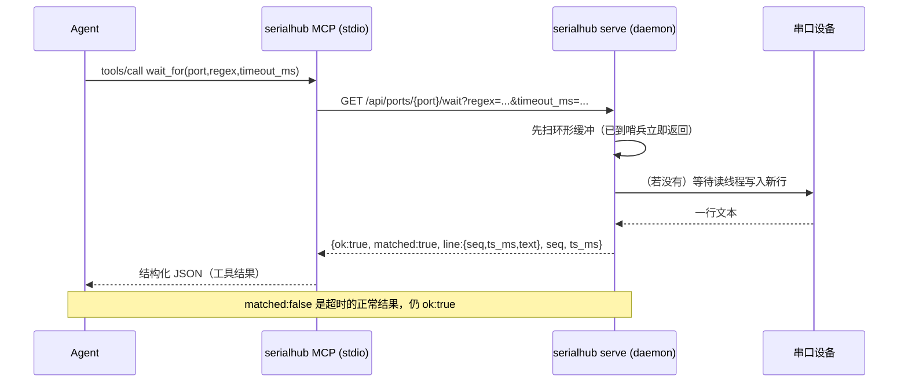

**简体中文** · [English](MCP.md)

# serialhub MCP 使用说明

本文件面向**要用 serialhub 操作串口的 AI agent**（以及为 agent 配置 MCP 的工程师）。
它把常驻守护 `serialhub serve` 暴露为 **16 个 MCP 工具**，让 agent 直接以工具调用完成
「列口 → 打开 → 等待/读取/搜索 → 发送 → 快照/导出/桥」的全流程（另有运行时改写：`set_device` / `discover`）。

> 契约来源：[`ARCHITECTURE.md`](ARCHITECTURE.md) §11；实现：[`../serialhub/mcp_server.py`](../serialhub/mcp_server.py)。
> 主手册：[`../README.zh-CN.md`](../README.zh-CN.md)。

---

## 1. 传输与进程模型

- **传输**：stdio（默认）。命令为 `python -m serialhub mcp --stdio`，或直接跑 `serialhub/mcp_server.py`。
- **瘦客户端**：MCP 服务器**不自己打开串口**；每个工具都通过 HTTP 调用常驻守护
  （`serialhub.client.Client`，stdlib `urllib.request`）。因此 **守护必须先起**（`serialhub serve`）。
- **非阻塞**：阻塞型工具（`wait_for`、`send+wait`）跑在 worker 线程（`asyncio.to_thread`），
  MCP 事件循环不会卡。
- **兼容**：`mcp_compat.py` 同时支持官方 SDK 1.x（`FastMCP`）与 2.x（`MCPServer`），
  代码无需按版本修改。

```
        ┌──────────────┐   MCP (stdio/JSON-RPC)   ┌──────────────────┐   HTTP/REST   ┌────────────────────┐
        │    Agent      │ ───────────────────────▶ │  serialhub MCP    │ ───────────▶  │  serialhub serve    │
        │  (tool calls) │ ◀─────────────────────── │  (stdio server)   │ ◀───────────  │  Hub + RingBuffer   │
        └──────────────┘   结构化 JSON 结果          └──────────────────┘  {ok,...}/    └─────────┬──────────┘
                                                                           {ok:false}             │ 串口 / TCP 桥
                                                                                                  ▼
                                                                                            (COMx / loop:// / ...)
```



---

## 2. 安装与自检

```powershell
pip install -r requirements.txt      # 运行时
pip install "mcp>=1.9"               # MCP 支持（或 pip install -r requirements-dev.txt）

# 协议自检（自写 stdio JSON-RPC 客户端，不需要守护）
python tools/mcp_smoke.py
#   initialize + tools/list -> 应打印 16 个工具，末尾 "# RESULT: PASS"

# 端到端冒烟（需先起守护）
python -m serialhub serve --config examples/config.yaml
python tools/mcp_smoke.py --full --tool-timeout 30
#   initialize + tools/list + list_ports -> "# RESULT: PASS"
```

`tools/mcp_smoke.py` 直接说 JSON-RPC 2.0（不依赖 SDK 客户端），因此它通过即证明
`initialize` / `tools/list` / `tools/call` 契约正确。

---

## 3. 注册到客户端

### opencode

```jsonc
"mcp": {
  "serialhub": {
    "type": "local",
    "command": ["python", "D:\\projects\\project\\h750\\keshe\\serialhub\\serialhub\\mcp_server.py"],
    "enabled": true,
    "environment": { "SERIALHUB_URL": "http://127.0.0.1:8765" }
  }
}
```

等价的模块写法（需能 `import serialhub`，例如已 `pip install -e .`）：
`"command": ["python", "-m", "serialhub", "mcp", "--stdio"]`。

### Claude Desktop（`claude_desktop_config.json`）

```json
{
  "mcpServers": {
    "serialhub": {
      "command": "python",
      "args": ["D:\\projects\\project\\h750\\keshe\\serialhub\\serialhub\\mcp_server.py"],
      "env": { "SERIALHUB_URL": "http://127.0.0.1:8765" }
    }
  }
}
```

### Cursor（`.cursor/mcp.json`）

```json
{
  "mcpServers": {
    "serialhub": {
      "command": "python",
      "args": ["D:\\projects\\project\\h750\\keshe\\serialhub\\serialhub\\mcp_server.py"],
      "env": { "SERIALHUB_URL": "http://127.0.0.1:8765" }
    }
  }
}
```

### DeepSeek Harness（DSH）

DSH 自带 `@deepseek-ai/dsh-mcp-client` 插件，注册只需改配置、无需改源码。把下面这段加进 DSH profile
的用户 patch 层 `~/.dsh/profiles/<profile>/cordis.patch.yml`：

```yaml
- insert:
    - id: serialhub-mcp
      name: '@deepseek-ai/dsh-mcp-client'
      config:
        serverName: serialhub
        transport: stdio
        command: 'E:\Anaconda3\python.exe'
        args:
          - 'D:\projects\project\h750\keshe\serialhub\serialhub\mcp_server.py'
        env:
          SERIALHUB_URL: 'http://127.0.0.1:8765'
```

保存 profile patch 后（配置 HMR 热重载），工具会以 `mcp__serialhub__*` 出现在运行中的会话里。定位
profile、验证步骤、踩坑与撤销的完整过程见 [`DSH.zh-CN.md`](DSH.zh-CN.md)。

### 环境变量

| 变量 | 默认 | 说明 |
|---|---|---|
| `SERIALHUB_URL` | `http://127.0.0.1:8765` | 守护基址（改端口时同步改这里） |
| `SERIALHUB_TOKEN` | 空 | 守护设了 `server.token` 时填同样的 Bearer token |

---

## 4. 错误约定

- **所有工具**统一返回 `{"ok": true, ...}` 或 `{"ok": false, "error": "<可读消息>"}`。
  MCP 的 JSON-RPC 层本身不报错；`ok:false` 出现在**工具结果内容**里。
- 常见错误映射（来自守护的 HTTP 层）：

| `error` 示例 | HTTP | 触发 |
|---|---|---|
| `connection failed: ...` | (客户端) | 守护没起 / 地址不对 |
| `unknown port: 'nope'` | 404 | 端口名不在配置里 |
| `<ValueError 文本>` | 400 | 参数非法（如 `export` 的 format 不认识） |
| `<RuntimeError 文本>` | 409 | 设备未打开就 `send` 等 |
| `invalid request` | 422 | 请求体缺字段 / 类型错 |
| `unauthorized` | 401 | 守护设了 token 但没带对 |

- **`wait_for` 超时不是错误**：15s 没等到就返回
  `{"ok": true, "matched": false, "line": null, "seq": null, "ts_ms": null, "from_seq": <起点>}`。
  agent 应据 `matched` 分流，而不是把超时当失败。

---

## 5. 工具参考（16 个）

约定：下文「参数表」中的默认值即工具签名默认值；「返回」省略公共的 `ok` / `port` 字段。

---

### 5.1 `list_ports`

列出系统串口 + 已配置端口（含 open 状态、缓冲统计、桥接状态）。

| 参数 | 类型 | 必填 | 默认 | 说明 |
|---|---|---|---|---|
| （无） | | | | |

返回关键字段：

| 字段 | 说明 |
|---|---|
| `system[]` | 系统串口：`{device, description, hwid}` |
| `ports[]` | 已配置口：`{name, device, description, open, baud, data_bits, parity, stop_bits, flow, rx_lines, tx_lines, last_error, reconnect_count, buffer, tcp_bridge}` |
| `buffer` | `{count, bytes, first_seq, last_seq, dropped_total}` |
| `tcp_bridge` | `{mode, port, host, active}` 或 `null` |

```json
{"ok":true,"system":[{"device":"COM11","description":"USB-SERIAL CH340","hwid":"USB VID:PID=1A86:7523"}],
 "ports":[{"name":"console","device":"COM11","open":true,"baud":921600,"buffer":{"count":1281,"bytes":91234,"first_seq":3,"last_seq":1284,"dropped_total":0},"tcp_bridge":null}]}
```

**何时用**：每次会话开始先列口；确认目标口是否已 open、缓冲里有多少行、游标起点（`first_seq`/`last_seq`）。

---

### 5.2 `open`

打开（或重开）某口，可覆盖波特率 / 设备路径。

| 参数 | 类型 | 必填 | 默认 | 说明 |
|---|---|---|---|---|
| `port` | str | 是 | | 逻辑口名（如 `console`） |
| `baud` | int | 否 | `115200` | 波特率覆盖 |
| `device` | str | 否 | `null` | 设备路径覆盖（`COM11` / `/dev/ttyUSB0`） |

返回：端口 dict（`open:true`，含 `buffer` / `tcp_bridge`）。

```json
{"ok":true,"name":"console","device":"COM11","open":true,"baud":921600,"data_bits":8,"parity":"N","stop_bits":1.0,"flow":"none","rx_lines":0,"tx_lines":0,"last_error":null,"reconnect_count":0,"buffer":{"count":0,"bytes":0,"first_seq":null,"last_seq":null,"dropped_total":0},"tcp_bridge":null}
```

**何时用**：口是 `autostart:false`，或刚 `close` 过需要重开时。

---

### 5.3 `close`

关闭某口（**缓冲保留**）。

| 参数 | 类型 | 必填 | 默认 |
|---|---|---|---|
| `port` | str | 是 | |

返回：端口 dict（`open:false`）。

```json
{"ok":true,"name":"console","device":"COM11","open":false,"baud":921600,"buffer":{"count":1281,"bytes":91234,"first_seq":3,"last_seq":1284,"dropped_total":0},"tcp_bridge":null}
```

**何时用**：让出串口给其它程序、或临时停采又不想丢历史。

---

### 5.4 `status`

守护/端口状态。省略 `port` 返回整体。

| 参数 | 类型 | 必填 | 默认 | 说明 |
|---|---|---|---|---|
| `port` | str | 否 | `null` | 省略则返回守护级状态 |

返回：给定 `port` → 单口 dict **加** `server`；省略 → `{server, ports[]}`。

| `server` 字段 | 说明 |
|---|---|
| `host` / `port` | 监听地址/端口 |
| `version` | serialhub 版本 |
| `uptime_ms` | 守护已运行毫秒 |

```json
{"ok":true,"server":{"host":"127.0.0.1","port":8765,"version":"0.1.0","uptime_ms":32045},"ports":[{"name":"console","open":true,"device":"COM11","last_error":null,"reconnect_count":0,"buffer":{"count":1281,"bytes":91234,"first_seq":3,"last_seq":1284,"dropped_total":0}}]}
```

**何时用**：健康检查、确认 `last_error` / `reconnect_count`（断线诊断）。

---

### 5.5 `read`

按游标**增量读取**缓冲行（不重复消费）。这是核心读取工具。

| 参数 | 类型 | 必填 | 默认 | 说明 |
|---|---|---|---|---|
| `port` | str | 是 | | 逻辑口名 |
| `since_seq` | int | 否 | `null` | 返回 `seq > since_seq`（**首选游标**） |
| `since_ts` | int | 否 | `null` | 无 `since_seq` 时按 `ts_ms > since_ts` |
| `filter` | str | 否 | `null` | 正则，仅返回匹配行 |
| `limit` | int | 否 | `null` | 最多返回行数 |
| `strip_ansi` | bool | 否 | `false` | 去 ANSI 转义 |

返回关键字段：

| 字段 | 说明 |
|---|---|
| `lines[]` | 旧→新：`{seq, port, ts_ms, text, ansi, kind}` |
| `count` | 本次行数 |
| `next_seq` | 下次续读游标（= 最后返回行的 `seq`） |
| `dropped` | 因缓冲淘汰而永久丢失的行数（游标早于 `first_seq-1` 时 >0） |
| `has_more` | 仍有满足条件的行未返回 |
| `first_seq` / `last_seq` | 当前缓冲最老/最新 `seq` |

```json
{"ok":true,"port":"console","lines":[{"seq":58,"port":"console","ts_ms":1730000000150,"text":"[BOOT] stage 2","ansi":false,"kind":"rx"}],"count":1,"next_seq":58,"dropped":0,"has_more":false,"first_seq":3,"last_seq":58}
```

**何时用**：常规取数。第一次用 `since_seq:0` 或先 `snapshot` 看起点；拿到 `next_seq` 后一直用它当 `since_seq`。
`dropped>0` 时改从 `first_seq` 续。

---

### 5.6 `search`

正则搜索全缓冲，可带上下文窗口（定位用，不是增量）。

| 参数 | 类型 | 必填 | 默认 | 说明 |
|---|---|---|---|---|
| `port` | str | 是 | | |
| `regex` | str | 是 | | 正则 |
| `context` | int | 否 | `0` | 命中的前/后各取几行 |
| `since_seq` | int | 否 | `null` | 只搜 `seq > since_seq` |
| `limit` | int | 否 | `null` | 最多命中数 |

返回关键字段：

| 字段 | 说明 |
|---|---|
| `hits[]` | `{seq, ts_ms, text, kind, match, context_before[], context_after[]}` |
| `count` | 命中数 |
| `next_seq` | 最后命中的 `seq`（可作续搜游标） |
| `regex` | 回显所用正则 |

```json
{"ok":true,"port":"console","hits":[{"seq":91,"ts_ms":1730000000444,"text":"[ERR] HardFault handler entered","kind":"rx","match":"HardFault","context_before":[{"seq":90,"ts_ms":1730000000440,"text":"[BOOT] started"}],"context_after":[{"seq":92,"ts_ms":1730000000446,"text":"pc=0x90001234"}]}],"count":1,"next_seq":91,"regex":"HardFault"}
```

**何时用**：`wait_for` 超时后排障（搜 `HardFault|ASSERT|panic`）；在长日志里定位状态转换。

---

### 5.7 `wait_for`

**阻塞**等待新行匹配正则（或超时）。核心哨兵工具。

| 参数 | 类型 | 必填 | 默认 | 说明 |
|---|---|---|---|---|
| `port` | str | 是 | | |
| `regex` | str | 是 | | 要等的哨兵 |
| `timeout_ms` | int | 否 | `10000` | 最长等待毫秒 |
| `since_seq` | int | 否 | `null` | 只看 `seq > since_seq` |

返回关键字段：

| 字段 | 说明 |
|---|---|
| `matched` | 命中为 `true`；超时为 `false`（**仍 `ok:true`**） |
| `line` | 命中行 `{seq, port, ts_ms, text, ansi, kind}` 或 `null` |
| `seq` / `ts_ms` | 命中行的序号/时间（超时为 `null`） |
| `from_seq` | 本次等待的起点游标 |

命中：
```json
{"ok":true,"port":"console","matched":true,"line":{"seq":57,"port":"console","ts_ms":1730000001234,"text":"[BOOT] Bootloader v1.3.0 starting","ansi":false,"kind":"rx"},"seq":57,"ts_ms":1730000001234,"from_seq":42}
```

超时：
```json
{"ok":true,"port":"console","matched":false,"line":null,"seq":null,"ts_ms":null,"from_seq":42}
```

行为细节：先扫环形缓冲，**已存在的匹配行立即返回**；否则订阅广播阻塞等待。给 `since_seq` 时只考虑 `seq > since_seq`。

**何时用**：等启动横幅 / 等命令提示符 / 等"OK/ERROR"结论文本。**永远用 `matched` 分流**。

---

### 5.8 `send`

向口写数据（追加 EOL），可选等待回复。

| 参数 | 类型 | 必填 | 默认 | 说明 |
|---|---|---|---|---|
| `port` | str | 是 | | |
| `data` | str | 是 | | 载荷（**不含**结尾） |
| `eol` | str | 否 | `"\r\n"` | `crlf`/`lf`/`cr`/`none` 或字面量 |
| `wait_regex` | str | 否 | `null` | 设了就阻塞等新行匹配它 |
| `timeout_ms` | int | 否 | `null` | `wait_regex` 的等待上限（缺省 10000） |

返回关键字段：

| 字段 | 说明 |
|---|---|
| `sent_bytes` | 实际写出字节数（含 EOL） |
| `sent` | 发送的文本 |
| `waited` | 是否进行了等待 |
| `matched` / `line` / `seq` | 等待命中信息（未等待或超时时 `matched:false`） |

发送并等回应：
```json
{"ok":true,"port":"console","sent_bytes":8,"sent":"reboot","waited":true,"matched":true,"line":{"seq":57,"port":"console","ts_ms":1730000001234,"text":"[BOOT] Bootloader v1.3.0 starting","ansi":false,"kind":"rx"},"seq":57}
```

发送（不等待）：
```json
{"ok":true,"port":"console","sent_bytes":8,"sent":"reboot","waited":false,"matched":false,"line":null,"seq":null}
```

注意：本进程发出的内容会以 `kind="tx"` 入缓冲（回显）；设备回复是 `kind="rx"`。
`wait_regex` 的起点取发送前的最新 `seq`，因此**只会匹配发送后出现的新行**。

**何时用**：下发命令；批量流程里直接`send`+`wait_regex`一步到位。

---

### 5.9 `snapshot`

取该口缓冲**末尾 N 行**（看当前现场）。

| 参数 | 类型 | 必填 | 默认 | 说明 |
|---|---|---|---|---|
| `port` | str | 是 | | |
| `tail_lines` | int | 否 | `200` | 末尾行数 |

返回：`{lines[], count, tail_lines, port}`。

```json
{"ok":true,"port":"console","tail_lines":200,"lines":[{"seq":1282,"port":"console","ts_ms":1730000009000,"text":"idle","ansi":false,"kind":"rx"}],"count":1}
```

**何时用**：会话开头快速看现场；等待前确认设备当前状态。

---

### 5.10 `export`

把该口缓冲导出到文件（raw / noansi / json）。**会写文件**。

| 参数 | 类型 | 必填 | 默认 | 说明 |
|---|---|---|---|---|
| `port` | str | 是 | | |
| `path` | str | 否 | `null` | 目标路径（缺省守护写入 `<cwd>/exports/<port>-<ts>.<ext>`） |
| `format` | str | 否 | `"raw"` | `raw` / `noansi` / `json`(JSONL) |
| `range` | str | 否 | `null` | seq 范围，如 `"100-500"` |

返回：`{path, bytes, format, count, port}`。

```json
{"ok":true,"port":"console","path":"D:\\...\\serialhub\\exports\\console-1730000010000.jsonl","format":"json","bytes":45120,"count":1284}
```

**何时用**：留证 / 交给别的工具分析；排障后落盘整段。

---

### 5.11 `tcp_bridge`

启动/停止/查看某口的 TCP 桥。

| 参数 | 类型 | 必填 | 默认 | 说明 |
|---|---|---|---|---|
| `action` | str | 是 | | `start` / `stop` / `status` |
| `port` | str | 是 | | 逻辑口名 |
| `tcp_port` | int | 否 | `null` | `start`（server 模式）必填 |
| `mode` | str | 否 | `"server"` | `server`（监听）/ `client`（连出） |
| `host` | str | 否 | `null` | client 模式：远端地址（必填）；server 模式：监听绑定地址（默认 `127.0.0.1`，传 `0.0.0.0` 可跨机访问） |

返回：`{port, mode, tcp_port, host, active}`；`action=status` 时额外含 `clients`（当前连接数）。

```json
{"ok":true,"port":"console","mode":"server","tcp_port":4001,"host":null,"active":true,"clients":1}
```

注意：server 模式默认绑定回环 `127.0.0.1`；`host` 参数在 server 模式即监听地址（传 `0.0.0.0` 可跨机 `nc`，并需放行防火墙）。client 模式连出到 `host:tcp_port`。

**何时用**：把串口喂给别的 TCP 工具 / 远端串口服务器的透传入口。

---

### 5.12 `mark`

在缓冲中插入带标签的标记行（`kind="mark"`）。

| 参数 | 类型 | 必填 |
|---|---|---|
| `port` | str | 是 |
| `label` | str | 是 |

返回：`{port, label, seq, ts_ms}`。

```json
{"ok":true,"port":"console","label":"before-reset","seq":42,"ts_ms":1730000000000}
```

**何时用**：给流程分段。之后 `search` 该标签或按 `seq` 定位阶段边界。

---

### 5.13 `clear`

清空该口环形缓冲（**破坏性**）。

| 参数 | 类型 | 必填 |
|---|---|---|
| `port` | str | 是 |

返回：`{port, cleared}`（`cleared` = 被清掉的行数）。

```json
{"ok":true,"port":"console","cleared":1284}
```

**何时用**：重新开始一次干净采集，避免旧行干扰 `since_seq=0`。

---

### 5.14 `reload`

从磁盘热重载守护配置。

| 参数 | 类型 | 必填 |
|---|---|---|
| （无） | | |

返回：`{added[], removed[], restarted[], updated[]}`。

```json
{"ok":true,"added":["c6"],"removed":[],"restarted":["console"],"updated":[]}
```

**何时用**：改过 `config.yaml` 后应用（增删口、改波特率/缓冲上限等）。缓冲区上限变化会**保留现有行**重建。

---

### 5.15 `set_device`

运行时改写某口用哪个 COM/设备，**无需**改配置文件、也不重启守护。改写是**临时的**（仅内存，不写入配置）。

| 参数 | 类型 | 必填 | 默认 | 说明 |
|---|---|---|---|---|
| `port` | str | 是 | | 逻辑口名 |
| `device` | str | 否 | `null` | 固定设备路径（`COM11` / `/dev/ttyUSB0`） |
| `match` | str \| dict | 否 | `null` | 自动发现规格：JSON 对象串（如 `'{"vid": "0x1A86", "pid": "0x7523"}'`）或 dict。键：`description`/`hwid`/`device`/`serial`（子串）、`vid`/`pid`（int 或十六进制）、`index` |
| `reopen` | bool | 否 | `true` | 立即重启 worker（缓冲保留）。为 `false` 时只改内存映射，于下次 open/重连生效 |

必须且只能给出 `device` / `match` 之一；两者都给或都不给都报错。`device` 设为固定路径（并清空 `match`）；
`match` 清空 `device`，交由 worker 在每次 open/重连时重新解析真实设备。

返回：端口 dict（与 `open` 同形，含 `device` / `open` / `buffer`）。

```json
{"ok":true,"name":"console","device":"COM12","open":true,"baud":115200,"buffer":{"count":9,"bytes":210,"first_seq":1,"last_seq":9,"dropped_total":0},"tcp_bridge":null}
```

**何时用**：守护在跑、目标换到了新的 COM；不重启就把某个逻辑口改指到别的适配器。要**持久化**映射，
请改配置后调用 `reload`。

---

### 5.16 `discover`

枚举系统串口设备，带序号、按设备名排序（即 `match` 解析所依据的池子）。

| 参数 | 类型 | 必填 |
|---|---|---|
| （无） | | |

返回：`{devices: [{index, device, description, hwid, vid, pid}...]}`。

```json
{"ok":true,"devices":[{"index":0,"device":"COM11","description":"USB-SERIAL CH343","hwid":"USB VID:PID=1A86:55D3","vid":6790,"pid":21971},{"index":1,"device":"COM12","description":"USB-SERIAL CH340","hwid":"USB VID:PID=1A86:7523","vid":6790,"pid":29987}]}
```

**何时用**：选 `match` 规格前（看有哪些 description / VID:PID），或找回拔插后当前的 COM。

---

## 6. Agent 操作手册（playbook）

### 6.1 游标增量（不重复消费）

- 首次读取：`snapshot` 看现场，或 `read(since_seq=0, limit=...)`。
- 记下返回的 `next_seq`，**下次原样传回** `since_seq=next_seq`。
- `wait_for` 命中的 `seq` 也是天然游标：随后 `read(since_seq=<该 seq>)` 接着读后续行。
- `dropped > 0` ⇒ 游标比缓冲最老行还早，有永久丢失；改从 `first_seq`（或最新）重来。

### 6.2 命令回显与设备输出分离

- 本进程发出 = `kind:"tx"`；设备返回 = `kind:"rx"`；`mark` = `kind:"mark"`。
- `read` 的过滤：MCP `read` 支持 `filter`（正则）；若要只看 rx，用 REST/CLI 的 `kinds`，
  或 MCP 里用 `filter` 配合文本特征。避免把回显当成设备回应。
- `wait_for` 只匹配**发送后出现的新行**（起点=发送前最新 `seq`），天然避开旧回显。

### 6.3 阻塞哨兵替代 sleep 轮询

- 用 `wait_for(port, regex, timeout_ms)` 等条件成立；命中即返回，比固定 sleep + read 更快更稳。
- **`matched:false` 是超时，不是错误**。分流：命中→消费后续；超时→`search` 排障 / `export` 留证。

### 6.4 send + wait 一步到位

- `send(port, data, eol="\r\n", wait_regex="OK|ERROR", timeout_ms=5000)` 返回直接带
  `matched` / `line` / `seq`，省一次往返。

### 6.5 搜索与导出

- 失败定位：`search(port, "HardFault|ASSERT|panic", context=2)`。
- 落证：`export(port, path="out/run.jsonl", format="json")`。

### 6.6 桥

- `tcp_bridge(action="start", port="console", mode="server", tcp_port=4001)` 把口喂给 TCP；
  `action="status"` 看 `clients`；`action="stop"` 收尾。

### 6.7 推荐典型循环

```
list_ports → open(port) → snapshot（看现场）→ mark("t0")
→ send(data, eol, wait_regex, timeout_ms) [或 send + wait_for]
→ 成功：read(since_seq=命中seq) 按序消费
→ 失败：search(...) → export(...)
→ close(port) / tcp_bridge(stop)
```

---

## 7. 完整示例：`wait_for` 等哨兵（端到端）

场景：一个 `console` 口，agent 发 `reboot` 后等固件打印启动横幅。`loop://` 演示口下
写出的字节会被立刻读回，因此步骤可无硬件复现（把 `demo` 换成你的真实口名即可）。

### 第 1 步：`list_ports`（确认口与初始游标）

```json
{}
```
```json
{"ok":true,"system":[],"ports":[{"name":"demo","device":"loop://","open":true,"baud":115200,"buffer":{"count":0,"bytes":0,"first_seq":null,"last_seq":null,"dropped_total":0},"tcp_bridge":null}]}
```

### 第 2 步：`open`（若未打开）

```json
{ "port": "demo" }
```
```json
{"ok":true,"name":"demo","device":"loop://","open":true,"baud":115200,"buffer":{"count":0,"bytes":0,"first_seq":null,"last_seq":null,"dropped_total":0},"tcp_bridge":null}
```

### 第 3 步：`mark`（分段）

```json
{ "port": "demo", "label": "reboot-cycle" }
```
```json
{"ok":true,"port":"demo","label":"reboot-cycle","seq":41,"ts_ms":1730000000000}
```

### 第 4 步：`send`（下发引导命令，不等待）

```json
{ "port": "demo", "data": "reboot", "eol": "\r\n" }
```
```json
{"ok":true,"port":"demo","sent_bytes":8,"sent":"reboot","waited":false,"matched":false,"line":null,"seq":null}
```

此刻 `kind:"tx"` 的回显 `reboot` 已入缓冲（`seq` 约 42），`loop://` 随即把同样字节读回为 `kind:"rx"`。

### 第 5 步：`wait_for`（阻塞等哨兵）

```json
{ "port": "demo", "regex": "reboot", "timeout_ms": 15000 }
```
```json
{"ok":true,"port":"demo","matched":true,"line":{"seq":43,"port":"demo","ts_ms":1730000000042,"text":"reboot","ansi":false,"kind":"rx"},"seq":43,"ts_ms":1730000000042,"from_seq":42}
```

- `matched:true`，命中行 `seq=43`，`ts_ms=...042`，`from_seq=42`（发送前最新序号）。
- **若 15s 内没等到**：`{"ok":true,"matched":false,"line":null,"seq":null,"ts_ms":null,"from_seq":42}`，
  agent 走失败分支，不进"消费"分支。

### 第 6 步：`read(since_seq=<命中 seq>)`（按序消费后续，无重复）

```json
{ "port": "demo", "since_seq": 43, "limit": 100 }
```
```json
{"ok":true,"port":"demo","lines":[],"count":0,"next_seq":43,"dropped":0,"has_more":false,"first_seq":41,"last_seq":43}
```

真实设备上这里会返回一批 `kind:"rx"` 的启动日志（`seq` 从 44 起），
`next_seq` 指向最后一行，供**下一次续读**继续用。**全程无重复消费**，这正是核心价值。

### 第 7 步（失败分支）：`search` + `export`

```json
{ "port": "demo", "regex": "HardFault|ASSERT|panic", "context": 2 }
```
```json
{"ok":true,"port":"demo","hits":[],"count":0,"next_seq":43,"regex":"HardFault|ASSERT|panic"}
```
```json
{ "port": "demo", "path": "out/demo.jsonl", "format": "json" }
```
```json
{"ok":true,"port":"demo","path":"D:\\...\\serialhub\\out\\demo.jsonl","format":"json","bytes":45120,"count":1284}
```

> 可运行的编程式等价流程见 [`../examples/mcp_client.py`](../examples/mcp_client.py)；
> 面向 agent 的简版 walkthrough 见 [`../examples/agent_wait_for.md`](../examples/agent_wait_for.md)。

---

## 8. 与 CLI 的对应关系

MCP 的每个工具都对应 CLI 子命令 / REST 端点，便于交叉验证：

| MCP 工具 | CLI | REST |
|---|---|---|
| `list_ports` | `list` / `ports` | `GET /api/ports` |
| `open` | `open` | `POST /api/ports/{n}/open` |
| `close` | `close` | `POST /api/ports/{n}/close` |
| `status` | `status` | `GET /api/status` |
| `read` | `read` | `GET /api/ports/{n}/read` |
| `search` | `search` | `GET /api/ports/{n}/search` |
| `wait_for` | `wait` | `GET /api/ports/{n}/wait` |
| `send` | `send` | `POST /api/ports/{n}/send` |
| `snapshot` | `snapshot` | `GET /api/ports/{n}/snapshot` |
| `export` | `export` | `POST /api/ports/{n}/export` |
| `tcp_bridge` | `bridge` | `POST /api/bridge` |
| `mark` | `mark` | `POST /api/ports/{n}/mark` |
| `clear` | `clear` | `POST /api/ports/{n}/clear` |
| `reload` | `reload` | `POST /api/reload` |
| `set_device` | `set-device` | `POST /api/ports/{n}/device` |
| `discover` | `discover` | `GET /api/devices` |

差异提示：MCP `read` **没有** `kinds` 参数（REST/CLI 有）；需要按 kind 过滤时走 REST/CLI，
或用 MCP `read` 的 `filter` 正则近似。
